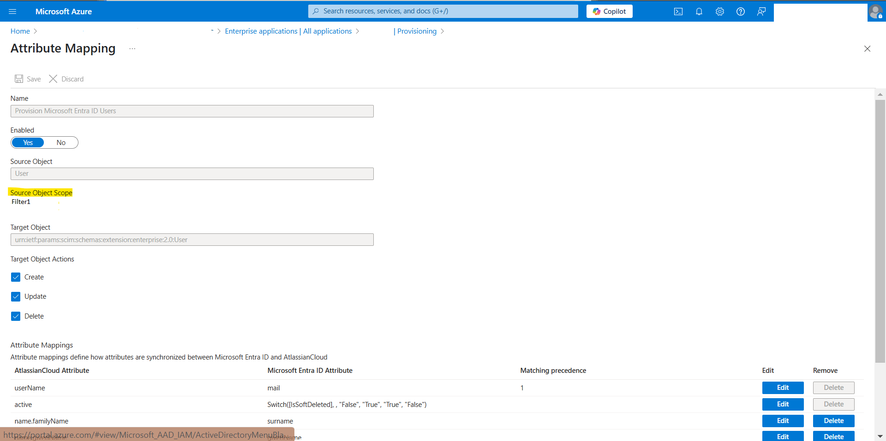
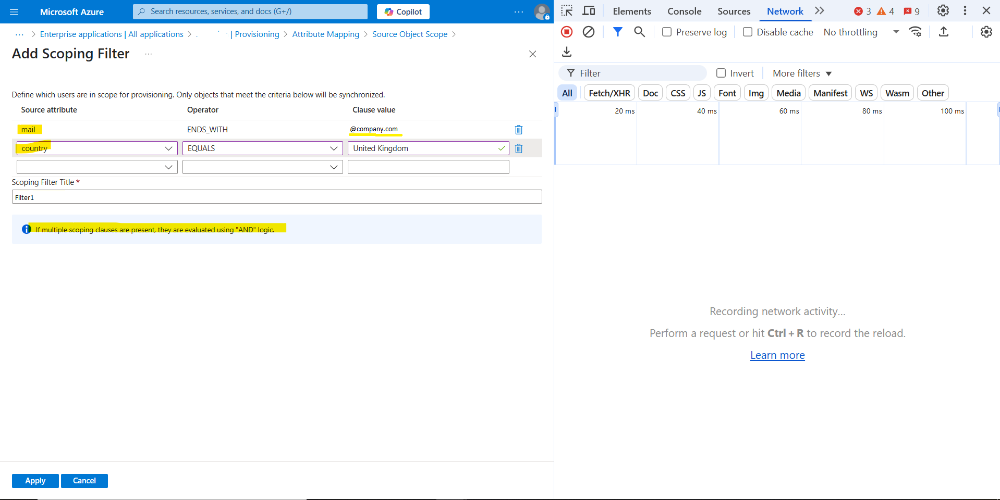
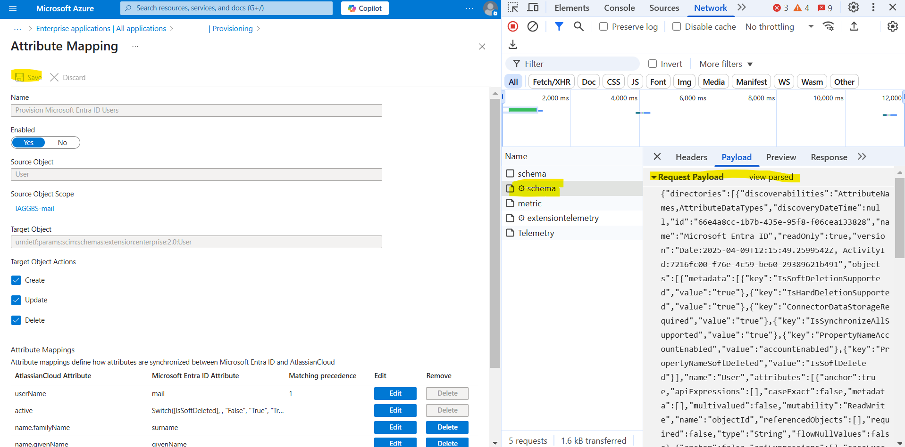

# SCIM Module

This module builds SCIM (System for Cross-domain Identity Management) configuration for Entra ID Applications. It enables automated user and group provisioning between Microsoft Entra ID and connected applications, following Company conventions.

---

## Table of Contents
- [Features](#features)
- [Important Note](#important-note)
- [Usage Example](#usage-example)
- [Variables](#variables)
  - [Required](#required)
  - [Optional](#optional)
- [Sync Settings Map](#sync-settings-map)
- [Attribute Mappings](#attribute-mappings)
- [Underlying Scripts](#underlying-scripts)
- [User Filtering](#user-filtering)
  - [Filter Syntax](#filter-syntax)
  - [How to Create User Filters](#how-to-create-user-filters)
- [How It Works](#how-it-works)
- [Notes](#notes)
- [Version History](#version-history)

---

## Features

- Configures SCIM provisioning for Microsoft Gallery applications with pre-created sync templates
- Securely retrieves SCIM credentials from 1Password
- Updates attribute mappings to correctly sync Company-specific user properties
- Supports custom sync settings including quarantine thresholds and notifications
- Implements advanced user filtering for precise provisioning scope
- Works around Entra ID API limitations with PowerShell scripts

---

## Important Note

<div class="warning" style='background-color:#E9D8FD; color:rgb(83, 122, 51); border-left: solidrgb(221, 170, 30) 4px; border-radius: 4px; padding:0.7em;'>
<span>
<p style='margin-top:1em; text-align:center'>
<b>IMPORTANT NOTE</b></p>
<p style='margin-left:1em;'>
In order to use this module your application must be created from the Microsoft Gallery template. Only this way sync job will be created from a pre-configured template. It is almost impossible to create them manually.
If application was not created with template - recreate it.
</p>
</span>
</div>

---

## Usage Example

```hcl
module "scim-config" {
  source                 = "git@github.com:Company-ORG/modules.git//scim?ref=v1.x.x"
  app_id                 = var.app_sp_id
  onepassword_vault_name = var.onepassword_vault_name
  onepassword_login_name = var.onepassword_login_name
  sync_settings_map      = var.sync_settings_map
  attribute_mappings     = var.attribute_mappings
}
```

---

## Variables

### Required

| Name | Type | Description |
|------|------|-------------|
| app_id | string | Application ID for which you configure SCIM |
| onepassword_vault_name | string | 1Password's vault name where SCIM secrets are stored. |
| onepassword_login_name | string | 1Password's credentials name, where SCIM creds are stored |
| sync_settings_map | map(string) | Map of sync settings (see details below) |
| attribute_mappings | map(string) | Map of standard attribute names vs Company specific attribute names |

### Optional

| Name | Type | Default | Description |
|------|------|---------|-------------|
| sync_job_template_id | string | "" | ID of sync template provided with application. Will use default one if omitted. |
| synchronization_job_enabled | bool | false | Enables users/groups synchronization. Set to false by default so you can review configuration. |
| users_filter | any | null | Definition of user filter to allow only certain users to be synced |

---

## Sync Settings Map

The default configuration for `sync_settings_map` should be:

```hcl
variable "sync_settings_map" {
  description = "Map of sync settings"
  type        = map(string)
  default = {
    Enabled                             = true,
    HumanResourcesLookaheadQueryEnabled = false,
    DeleteThresholdEnabled              = true,
    DeleteThresholdValue                = 6,
    Recipients                          = "identity.support@company.com"
  }
}
```

- **Enabled**: Specifies if sync job should be running once created
- **HumanResourcesLookaheadQueryEnabled**: Default value used
- **DeleteThresholdEnabled**: If job should be stopped when a certain number of users are removed
- **DeleteThresholdValue**: Number of users removed before job is quarantined (default: 6)
- **Recipients**: Email address for quarantine notifications

---

## Attribute Mappings

This variable updates sync job attribute mappings with Company-specific values. For example:

- Company UPNs for guest accounts look like `user.surname_domain##EXT##@google.com` - we should send email instead
- Employee IDs at Company are stored in the mailnickname attribute

The script will iterate through all values and update the sync job accordingly.

---

## Underlying Scripts

### Get-TemplateID
Retrieves the ID of the default sync job template from the Microsoft Gallery application

### Scim-Schema-Update
Updates the sync job schema based on attribute_mappings variable values

### Set-SCIM-Credentials
Updates synchronization secrets and settings for the service principal, working around an Entra ID API bug

---

## User Filtering

The module supports advanced user filtering to control which users are provisioned to the application.

### Filter Syntax

Filter for all users with accounts enabled and email ending with @Company.com:

```json
"scope": {
    "categoryFilterGroups": [],
    "groups": [
        {
            "clauses": [
                {
                    "operatorName": "ENDS_WITH",
                    "sourceOperandName": "mail",
                    "targetOperand": {
                        "values": [
                            "@Company.com"
                        ]
                    }
                },
                {
                    "operatorName": "IS TRUE",
                    "sourceOperandName": "accountEnabled",
                    "targetOperand": null
                }
            ],
            "name": "Company users"
        }
    ],
    "inputFilterGroups": []
}
```

Filter for users with empty city property OR mail ending with @Company.com:

```json
"scope": {
    "categoryFilterGroups": [],
    "groups": [
        {
            "clauses": [
                {
                    "operatorName": "ENDS_WITH",
                    "sourceOperandName": "mail",
                    "targetOperand": {
                        "values": [
                            "@Company.com"
                        ]
                    }
                }
            ],
            "name": "Company users"
        },
        {
            "clauses": [
                {
                    "operatorName": "IS NULL",
                    "sourceOperandName": "city",
                    "targetOperand": null
                }
            ],
            "name": "City-Filter"
        }
    ],
    "inputFilterGroups": []
}
```

### How to Create User Filters

1. Navigate to **Enterprise Applications** > **Your application** > **Provisioning**. Select **Manage** > **Provisioning**.
   Expand **Mappings** and select **Provision Microsoft Entra ID Users**.
   

2. Define one or multiple filters you wish to use. 
   **Note!** Multiple conditions in the same filter group are evaluated with AND logic. Multiple filters in the same filter group are evaluated with OR logic.
   

3. Turn on "Developer tools" in your browser and capture the POST request generated by Entra ID portal.
   

4. Look for changes under `synchronizationRules -> objectMappings[1] -> scope`

5. Format the JSON for Terraform:
   ```hcl
   groups = [
   {
     clauses = [
       {
         operatorName      = "ENDS_WITH"
         sourceOperandName = "mail"
         targetOperand = {
           values = ["@company.com"]
         }
       },
       {
         operatorName      = "IS TRUE"
         sourceOperandName = "accountEnabled"
         targetOperand     = null
       }
     ]
     name = "Company users"
   }
   ]
   ```

---

## How It Works

- The module configures SCIM for Microsoft Gallery applications with pre-created sync templates
- It retrieves SCIM credentials from 1Password for secure authentication
- Custom attribute mappings ensure Company-specific user properties are correctly synchronized
- PowerShell scripts handle operations not supported by Terraform
- Advanced user filtering allows precise control over which users are provisioned

---

## Notes

- Only works with applications created from the Microsoft Gallery template
- Requires pre-created SCIM credentials in the 1Password "Data" vault
- Sync jobs are disabled by default to allow review before enabling
- Filter conditions in the same group use AND logic; different groups use OR logic

---

## Version History

| Version | Description | Breaking Changes |
|---------|-------------|------------------|
| v1.0.0  | Initial release | N/A          |
| v1.0.1  | Documenting Module | N/A       |

---